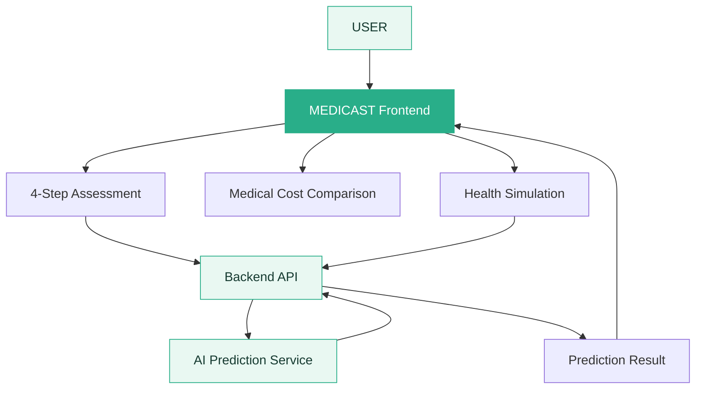

<div align="center">


<br/>
<br>

---
<br>
<br>

</div>

<div align="center">


### Predict Your Health. Prepare Your Future.

**데이터로 예측하는 나의 의료비, 더 나은 건강을 위한 시작.**

MEDICAST는 개인의 건강 및 생활 데이터를 기반으로  
향후 1년간의 의료비를 예측하고 건강한 선택을 돕는 AI 기반 웹서비스입니다.

<br/>


<br/><br/>

[Frontend](https://github.com/2026-DDJ/FE) · [Backend](https://github.com/2026-DDJ/BE) · [AI](https://github.com/2026-DDJ/AI)

</div>

<br/>

<br/>

## 01. About MEDICAST

### 의료비를 예측하고, 건강의 미래를 설계하다.

우리는 자신의 건강 상태를 알고 있어도  
앞으로 얼마나 많은 의료비가 발생할지 쉽게 예상하기 어렵습니다.

**MEDICAST**는 이러한 불확실성을 줄이기 위해 시작되었습니다.

개인의 생활 습관, 건강 상태, 의료 이용 기록을 분석하여  
예상 의료비를 제공하고, 다양한 조건에서의 변화를 비교할 수 있도록 돕습니다.

<br/>

<div align="center">

| PREDICT | COMPARE | SIMULATE |
|:---:|:---:|:---:|
| 🩺 | 📊 | 🌱 |
| **의료비 예측** | **집단별 의료비 비교** | **건강 변화 시뮬레이션** |
| 개인 데이터 기반<br/>연간 의료비 예측 | 비슷한 조건의 집단과<br/>예측 결과 비교 | 생활 습관 변화에 따른<br/>예상 의료비 비교 |

</div>

<br/>

<br/>

## 02. Key Features

### 01 — AI Medical Cost Prediction

**나의 데이터를 기반으로 미래 의료비를 예측합니다.**

사용자는 4단계 설문을 통해 자신의 생활 환경과 건강 정보를 입력합니다.

| STEP | CATEGORY | DETAILS |
|:---:|---|---|
| 01 | 생활·경제 정보 | 가구원 수, 소득, 지역, 직업 |
| 02 | 건강 상태 및 생활 습관 | BMI 관련 신체 정보, 운동, 주관적 건강 상태 |
| 03 | 의료 이용 기록 | 외래 및 치과 이용 횟수, 입원 여부 |
| 04 | 보험 정보 | 건강보험 유형, 실손보험 가입 여부 |

입력된 데이터는 백엔드 API를 통해 AI 예측 시스템에 전달되며, 향후 1년간의 예상 의료비가 제공됩니다.

<br/>

### 02 — Medical Cost Comparison

**나와 비슷한 사람들은 얼마나 지출할까요?**

AI가 예측한 개인 의료비를 다양한 비교 집단의 평균과 함께 시각화합니다.

- 나의 예상 연간 의료비
- 동일 소득 구간 평균 의료비
- 동일 외래 이용 횟수 구간 평균 의료비
- 전체 평균 의료비

막대그래프를 통해 자신의 예상 의료비를 직관적으로 비교할 수 있습니다.

<br/>

### 03 — Health Simulation

**생활 습관이 달라진다면 예상 의료비는 어떻게 변할까요?**

사용자가 건강 관련 조건을 직접 변경하여 예상 의료비의 변화를 확인할 수 있습니다.

| VARIABLE | DESCRIPTION |
|---|---|
| BMI | 체질량지수 조절 |
| Exercise | 규칙적인 운동 여부 변경 |
| Prediction | 변경된 조건으로 의료비 재예측 |
| Comparison | 변경 전후 금액 및 증감률 비교 |

단순한 의료비 예측을 넘어, 다양한 건강 조건에 따른 예측 결과를 탐색할 수 있습니다.

> 본 서비스의 예측 결과는 통계적 추정이며, 실제 의료비나 생활 습관 변화의 인과적 효과를 보장하지 않습니다.

<br/>

### 04 — Interactive Experience

**복잡한 의료 데이터를 직관적인 경험으로.**

- Three.js 기반 3D 인체 모델
- 단계별 설문 인터페이스
- 데이터 시각화 및 결과 비교
- PC 및 모바일 반응형 UI
- 예측 로딩 및 오류 상태 처리

<br/>

<br/>

## 03. Tech Stack

<div align="center">

| Category | Technologies |
|:---:|---|
| **Core** | React 19, JavaScript |
| **Build** | Vite 8 |
| **Styling** | Styled Components 6, CSS |
| **Routing** | React Router DOM 7 |
| **3D Graphics** | Three.js |
| **Networking** | Fetch API |
| **Code Quality** | Oxlint |
| **Testing** | Node.js Test Runner |

</div>

<br/>

<br/>

## 04. System Architecture



프론트엔드는 사용자 입력과 결과 시각화를 담당하며, 백엔드를 통해 의료비 예측 및 시뮬레이션 기능을 호출합니다.

<br/>

<br/>

## 05. Project Structure

```text
MEDICAST-FE
│
├── docs/                   # 연동 및 모델 입력 문서
├── scripts/                # 보조 스크립트
├── src/
│   ├── api/                # API 요청 및 예측 관련 로직
│   ├── assets/             # 이미지, 폰트, 3D 모델
│   ├── components/         # 재사용 UI 컴포넌트
│   ├── data/               # 데이터 리소스
│   ├── pages/
│   │   ├── analysis/       # 의료비 설문 및 예측 결과
│   │   ├── simulation/     # 건강 조건 시뮬레이션
│   │   ├── Main.jsx        # 메인 페이지
│   │   ├── Intro.jsx       # 인트로
│   │   ├── Login.jsx       # 로그인 화면
│   │   └── Signup.jsx      # 회원가입 화면
│   ├── styles/             # 페이지별 스타일
│   ├── utils/              # 검증 및 변환 유틸리티
│   ├── App.jsx             # 라우팅
│   └── main.jsx            # 애플리케이션 진입점
│
├── tests/                  # 단위 테스트
├── package.json
└── vite.config.js
```

<br/>

<br/>

## 06. Getting Started

### Prerequisites

- Node.js 및 npm
- 실행 가능한 백엔드 API 서버

### Installation

```bash
git clone https://github.com/2026-DDJ/FE.git
cd FE
npm install
```

### Environment Variables

프로젝트 루트에 `.env` 파일을 생성합니다.

```env
VITE_API_BASE_URL=https://medicast-be.onrender.com
```

환경변수를 설정하지 않으면 코드에 지정된 기본 API 주소를 사용합니다.

### Development

```bash
npm run dev
```

### Build

```bash
npm run build
```

### Preview

```bash
npm run preview
```

### Lint & Test

```bash
npm run lint
node --test tests/*.test.js
```

<br/>

---

<br/>

## 07. API Integration

MEDICAST 프론트엔드는 다음과 같은 예측 API를 사용합니다.

| Method | Endpoint | Description |
|:---:|---|---|
| POST | `/predictions` | 설문 기반 의료비 예측 요청 |
| GET | `/predictions/{predictionId}` | 예측 상태 및 결과 조회 |
| POST | `/predictions/{predictionId}/simulations` | 조건 변경 시뮬레이션 |

예측 처리 과정에서는 비동기 상태를 관리하며, 완료되지 않은 작업은 폴링하여 결과를 확인합니다.

추가적인 연동 내용은 [Backend Integration](./docs/backend-integration.md) 문서에서 확인할 수 있습니다.

<br/>

<br/>

## 08. Team DDJ

<div align="center">

**Different Data, Just for You.**

| NAME | ROLE | RESPONSIBILITY |
|:---:|:---:|---|
| **박지수** | AI · Planning | 의료비 예측 모델 개발 및 기획 |
| **박영서** | Frontend · Design | UI/UX 디자인 및 프론트엔드 개발 |
| **최서아** | Backend · Data | 데이터 전처리 및 백엔드 API 개발 |

<br/>

**2026 · MEDICAST**

*Making healthcare more predictable.*

</div>
